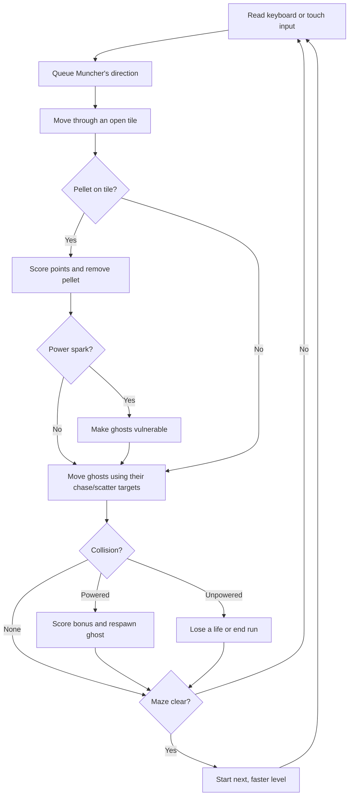

# Muncher — Afterhours Arcade

A recruiter-ready, original maze-chaser built with Vue 3, TypeScript, and Canvas. Guide Muncher through a glowing maze, clear every spark, and outwit four distinct pursuers. No backend or external game assets required.

**Play:** [oscarmmi.github.io/pacman](https://oscarmmi.github.io/pacman/)

## How to play

- Move with **Arrow keys** or **WASD**. On a phone, use the on-screen directional pad.
- Collect every small spark to clear the maze. Large golden sparks temporarily power Muncher up.
- While powered, touch a ghost to score bonus points and send it back to its starting corner.
- You have **three lives**. Ghosts become quicker as you clear each level.
- Press **Space** to pause and **R** to start a fresh run.
- Your personal best is saved in this browser with `localStorage`.

The four ghosts have different colors and simple chase/scatter personalities: Ember pursues directly, Aqua aims ahead, Pink patrols a wider angle, and Butter hangs back until Muncher gets close.

## Run locally

```sh
npm install
npm run dev
```

Run the game-logic tests and production build:

```sh
npm test
npm run build
```

## Game loop



## Deployment

GitHub Actions runs the tests and builds `dist/` on every push to `main`, then publishes it to GitHub Pages: [https://oscarmmi.github.io/pacman/](https://oscarmmi.github.io/pacman/).
